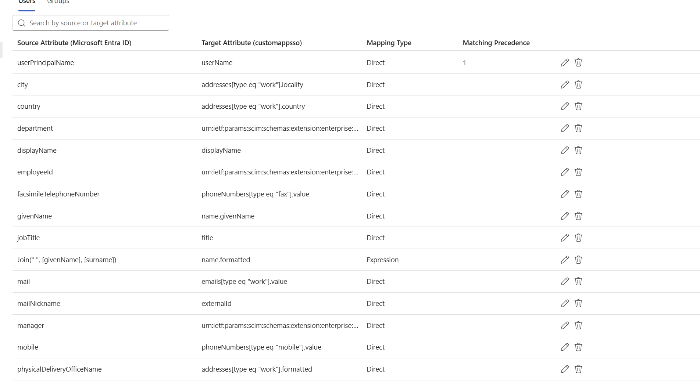
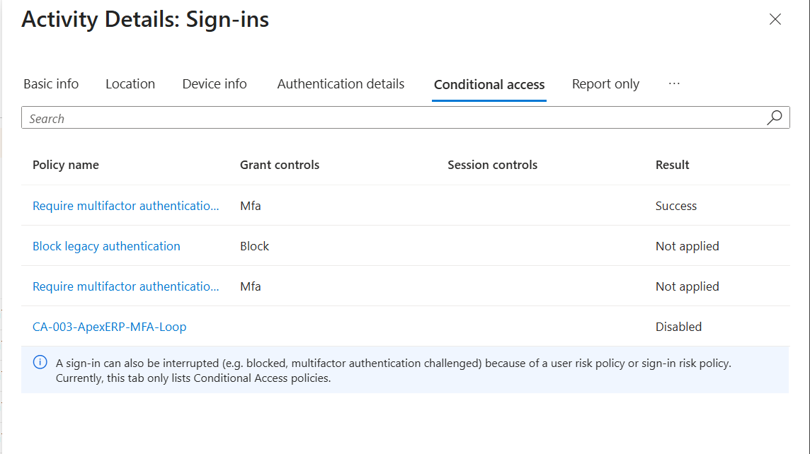
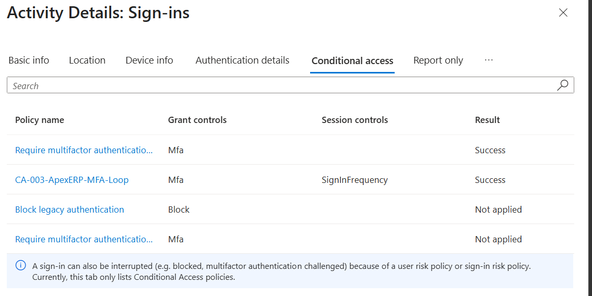
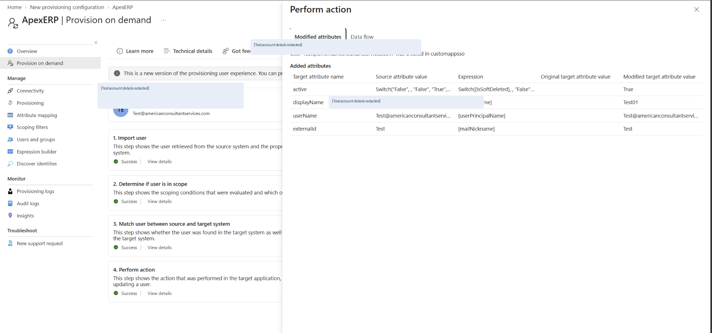
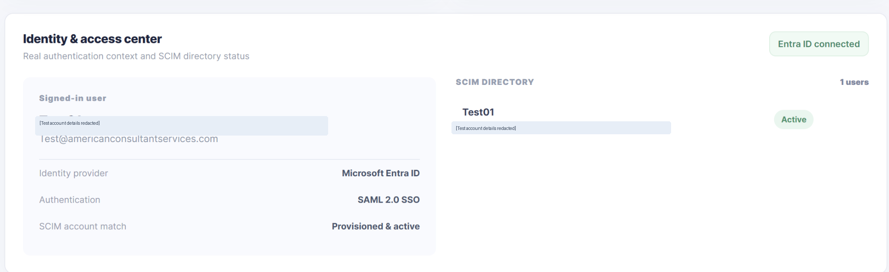
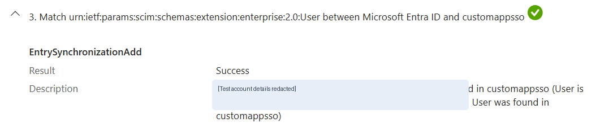

<div align="center">
  

# ApexERP Finance | Microsoft Entra ID IAM Lab

**Hands-on identity engineering portfolio: SAML 2.0 SSO · X.509 signing certificates · Conditional Access/MFA · SCIM 2.0 · Joiner–Mover–Leaver**

[Live demo preview](https://apexerp-finance.onrender.com/preview) · [Full technical case study](docs/IAM-LAB-CASE-STUDY.md)
</div>

> **Lab environment only.** ApexERP Finance is a custom learning application with fictional financial data, not a production finance system. The Render-hosted preview is unauthenticated demonstration data; the actual finance dashboard uses Microsoft Entra ID SAML SSO.

## Overview

Built and deployed a custom enterprise finance integration target, then configured Microsoft Entra ID authentication and identity lifecycle provisioning. Reproduced and diagnosed failures using Entra sign-in/provisioning logs, SAML-tracer, application logs, and certificate comparisons. All exercises were performed in a lab tenant.

## Architecture

```text
Microsoft Entra ID (Identity Provider)
   |-- SAML 2.0 SSO + X.509 signing --> ApexERP Finance (Node.js on Render)
   |-- Conditional Access + MFA -----> Sign-in policy evaluation
   `-- SCIM 2.0 /Users + /Groups ----> ApexERP SCIM directory

GitHub repository ---> Render deployment
```

## Completed labs

| Exercise | Outcome / evidence |
| --- | --- |
| Non-gallery enterprise application | Registered ApexERP Finance and configured SAML identifiers, ACS, issuer, and Entra login URL |
| SAML SSO | Verified sign-in of assigned test user to the protected finance dashboard |
| SAML signing certificate investigation | Created an inactive second certificate; captured SAML response in SAML-tracer; located `ds:X509Certificate`; matched certificate thumbprints |
| Certificate rotation incident | Activated replacement certificate before updating application trust; observed `Invalid document signature`; updated Render trusted certificate; restored login |
| Conditional Access MFA session lab | Tested baseline MFA, scoped an  `Every time` sign-in frequency policy to test app and user, observed repeated prompting, changed to 8-hour periodic reauthentication, verified reduced prompts |
| SCIM user lifecycle: Joiner | Provision on Demand created Test01 and marked account `active=true` |
| SCIM user lifecycle: Mover | Updated Entra user's job title to `Senior Financial Analyst`; provisioning updated the target attribute |
| SCIM user lifecycle: Leaver | Removed app assignment; provisioning `disable` action observed; target account marked Inactive |
| SCIM reassignment investigation | Reassignment/provisioning produced `create` instead of reusing prior target ID; Entra matching said no matching account; investigated local ephemeral storage limitation |

## Lab screenshots

**Attribute mappings**



**Conditional Access results**





**Provision on Demand**



**Identity & Access Center**



**SCIM matching investigation**



## Technical learning and troubleshooting

- **SAML != SCIM:** SAML signs users into the application; SCIM creates, updates, and disables target identities.
- **Certificate rotation:** Coordinate identity provider signing certificate activation with service-provider trust update. Verify the signature against the expected key; use thumbprints to compare certificate identity.
- **MFA prompts:** A successful Conditional Access policy result does not mean the experience is optimal. Session controls can trigger frequent reauthentication. In the test, a fresh MFA challenge was not observed on the final second login.
- **Deprovision vs reactivation:** An Entra `disable` event and inactive application record were verified, but later reassignment created a **new target identifier**. Reactivating the *same* target ID was not demonstrated.
- **Ephemeral data limitation:** The custom lab's `DATA_DIR=./data` on Render Free is not persistent. No database migration was implemented; this limitation is intentionally documented and accepted for the lab.

## Repository and deployment notes

The source code in this repo includes an intentionally lightweight Node.js SAML/SCIM integration application. Never commit `.env`, access tokens, signing secrets, SAML assertions, or provisioning exports containing private identifiers. Use Render environment variables for credentials. A working instance needs `APP_BASE_URL`, `ENTRA_LOGIN_URL`, `ENTRA_ISSUER`, `ENTRA_CERT_BASE64`, `SESSION_SECRET`, and `SCIM_BEARER_TOKEN` as described in the application configuration template.

**Security scope:** Only synthetic/test identities should be used. The public `/preview` endpoint is a static demo, not proof of authorization or a real finance system. The current simple SCIM storage is not suitable for production; see the technical case study.

---

*Portfolio project demonstrating hands-on Microsoft Entra ID integration and IAM troubleshooting.*
