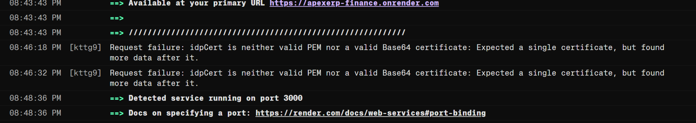
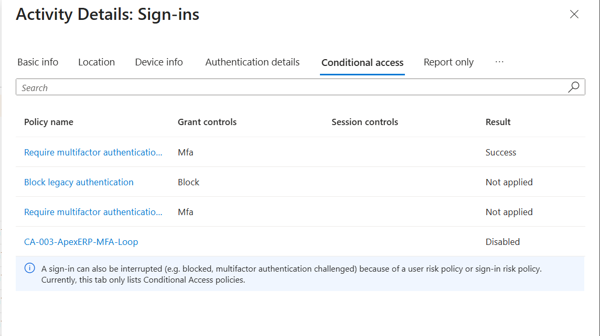
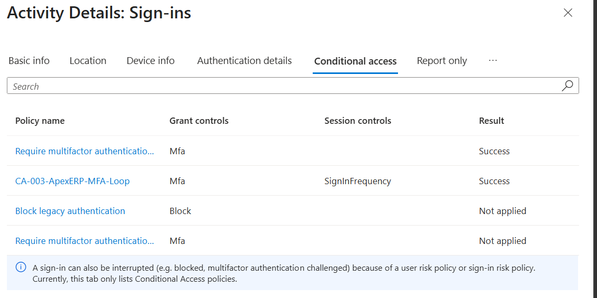
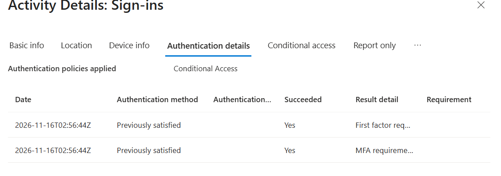
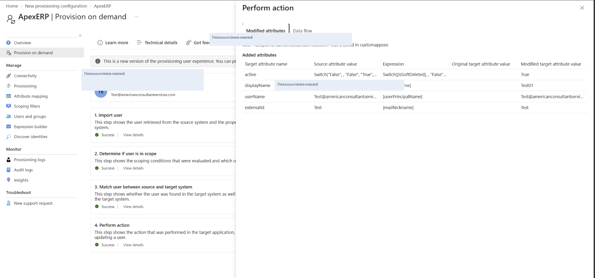
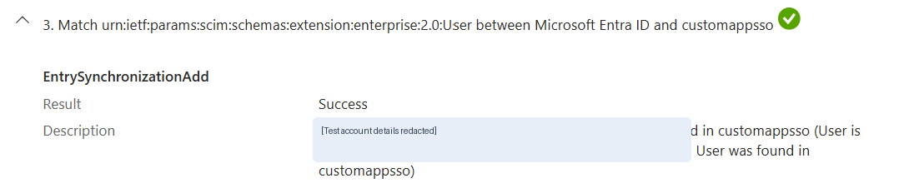

# ApexERP Finance — IAM Engineering Case Study

## Goal and environment

Create a reusable custom finance application to practice enterprise identity integration: SAML-based SSO, X.509 signing certificate management, Microsoft Entra Conditional Access and MFA, and SCIM 2.0 user lifecycle provisioning. Environment: a lab Microsoft Entra tenant, Microsoft Entra P1 trial for Conditional Access, Node.js application deployed via GitHub to Render.

## 1. Integration / baseline

1. Created the `ApexERP Finance` non-gallery enterprise application in Entra ID.
2. Configured Entity ID, ACS Reply URL, and application login URL for the Render deployment.
3. Configured the Entra Login URL, Entra issuer, and active signing certificate in Render environment variables.
4. Assigned a test user and verified SAML SSO to the finance dashboard.
5. Captured the SAML response at `/saml/acs` with SAML-tracer and found `ds:X509Certificate`. Compared its SHA-1 thumbprint with Entra's active signing certificate; match verified.

## 2. SAML certificate rotation failure and recovery

**Change:** Created a second certificate and activated it in Entra before changing the trusted certificate in the application. The service provider continued to trust the first certificate.

**Symptom:** ApexERP Finance displayed `Request could not be completed`. Render logs showed `Request failure: Invalid document signature`.

**Diagnosis:** The application verified a new SAML signature using outdated signing certificate material. Also resolved a PEM-versus-double-Base64 configuration mistake during initial integration.

**Remediation:** Downloaded the new active Entra signing certificate, replaced the Render certificate value with properly formatted PEM, redeployed, and validated successful SAML login.

**Lesson:** Coordinate signing rollover with service-provider certificate trust. Thumbprint matches identify certificate identity, but do not replace cryptographic signature verification.

## 3. Conditional Access repeated MFA prompts

**Baseline:** MFA required and successful; sign-in logs initially included `Previously satisfied` and MFA claims satisfied by an existing token. Security Defaults were initially enabled; the tenant later transitioned to P1 Conditional Access with baseline MFA and legacy authentication policies.

**Experiment:** Scoped test policy `CA-003-ApexERP-MFA-Loop` to a regular P1-licensed test user and ApexERP Finance, excluding administrator accounts. Enforced MFA plus `Sign-in frequency = Every time`.

**Observation:** Repeated MFA was encountered on a later sign-in after the policy change. Logs showed the test policy succeeded and applied `SignInFrequency`. This was excessive reauthentication, **not** a literal infinite MFA loop.

**Remediation:** Changed to `Periodic reauthentication = 8 hours`, retained MFA requirements. User later confirmed the second login did not prompt for MFA again. Eight hours was a lab choice, not a universal production recommendation.

## 4. SCIM Joiner–Mover–Leaver lifecycle

**Connection:** Configured automatic provisioning connection to `/scim/v2` with a bearer token stored in Render, and verified `Test Connection` success.

**Joiner:** Provision on Demand created the test user. The ApexERP dashboard verified `SCIM Directory: 1 user`, with `Active` and SAML/SCIM match.

**Mover:** Changed the Entra test user job title to `Senior Financial Analyst`. Provision on Demand reported a successful modified `title` attribute.

**Leaver:** Removed the user's enterprise app assignment. Entra audit logs showed successful removal; provisioning logs showed `Action: disable`, and the finance application's SCIM directory subsequently marked the account Inactive.

**Reassignment:** After reassigning the user and running provisioning, the application showed the user Active, but Entra performed `EntryExportAdd` / `EntrySynchronizationAdd`, with `no matching User was found`. The new target ID differed from the earlier disabled target ID. This is **new-account creation**, not verified reactivation of the original record.

## 5. Known limitation intentionally left unresolved

The application uses `const dataDir = path.resolve(process.env.DATA_DIR || './data')` and Render was configured with `DATA_DIR=./data`. On Render Free, local filesystem writes are ephemeral across instance restarts/deployments; the disappearing user record is consistent with this design, but exact root cause was not independently proven. The user chose not to migrate storage because this is a practice lab.

**Production improvements:** durable external database or persistent disk, consistent SCIM matching behavior for disabled users, idempotent create/upsert checks, token rotation, access control on SCIM directory display, audit logging, and automated contract tests.

## 6. Recruiter-friendly outcomes

- Implemented a custom Microsoft Entra ID SAML 2.0 SSO integration with a non-gallery application.
- Investigated a certificate rollover failure using SAML-tracer, `ds:X509Certificate`, certificate thumbprints, and application logs; restored service.
- Reproduced excessive MFA prompting caused by Conditional Access sign-in frequency and validated a targeted session-control remediation.
- Tested SCIM 2.0 Joiner, Mover and Leaver operations, including deactivation verification and investigation of failed target identity matching.

*All results were collected in a nonproduction training tenant. Screenshots have identifying details redacted; no tokens or live assertions included.*
